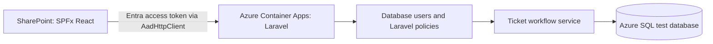

# Laravel backend preview

## Architecture



SharePoint hosts the UI; Entra authenticates identity; Laravel owns users, authorization and mutations. SharePoint groups, browser storage, request bodies and token app-role claims do not grant API privileges. Database reads are scoped before returning tickets. The session's role rules control presentation only. Calling the API directly does not expand access.

Deployments support a dedicated organization or multiple approved organizations in one shared database. See [organization deployment modes, onboarding and suspension](organization-deployments.md). Every customer role is scoped to its organization. Backend user IDs are not SharePoint user IDs. Controllers coordinate requests, Form Requests validate input, policies check access, and `TicketWorkflow` owns updates and status timestamps. Updates lock the ticket row; mutations and audit inserts share transactions. Audit records are not a tamper-proof compliance ledger.

## Current scope

The UI baseline is the `dev` branch. Laravel now implements the original settings-page service contracts instead of separate backend-specific settings panels. See the [dev branch adaptation audit](dev-branch-adaptation-audit.md) for the corrections and remaining functional ports.

Ticket descriptions are optional. The original helpdesk migration now defines a nullable `description`; omitted or blank descriptions are stored as SQL NULL and presented as empty text through the API. This migration edit is for the agreed disposable test-database rebuild. Existing databases do not change merely by deploying this source, and existing data must not be reset in production. The deployed `sql-test-1` image predates this change. On Azure SQL, do not use `migrate:fresh`: the current framework's table-wipe SQL uses unavailable `sp_msforeachtable`. A previously attempted wipe removed foreign keys from the Azure test database; that database needs its schema rebuilt before further application testing.

| Role | Visibility | Operations |
| --- | --- | --- |
| Requester | Requested or created by self, within accessible departments | Create as self; comment |
| Agent | Assigned to or created by self by default, within accessible departments | Actions and visibility configurable per department |
| Helpdesk Admin | All within their departments by default | Department permissions and lookup management; ticket operations according to department rules |
| Super Admin | All within organization | Admin operations plus user administration |

Only enabled agents/admins with access to the ticket department may be assigned. Agents cannot close/reopen terminal tickets or clear resolution summaries. They can assign tickets they created; other actions follow department permissions and handling scope. Requester identity is immutable. User access, memberships, group mappings and role settings are checked on every request. Super Admins cannot edit their own user access through the API. See [departments and classifications](departments-and-classifications.md) for the full boundaries and group-claim limitations.

Implemented: ticket creation/listing/editing, paginated reads, per-ticket bulk updates, plain text comments, history, first-response tracking, user editing, token validation, department memberships, group mappings, per-department Agent/Admin visibility/action/page settings, classification tables, Ticket Source/Type/Due Date, workspace metadata and read-only schema inspection. Existing React pages consume Laravel adapters. Assigned submissions start In Progress and unassigned submissions New, matching dev. Role names remain the four built-in roles; creating custom role types is not implemented.

Knowledge Base and Need Help now use department-scoped Laravel articles, including published visibility, drafts from tickets, classification links, article management and sanitized rich text. Users can delete their own ticket comments only within the first ten minutes; Laravel enforces the author and time checks.

**Still to port:** attachments, rich conversations, custom role types and remaining feature permissions, automatic team routing, email delivery/in-app notifications, requester/on-behalf edits, department transfers, SLA runtime calculations/pause tracking/escalations, view tracking, permanent deletion and runtime custom-field management. Existing controls are reused; unimplemented operations are disabled or explicitly unavailable rather than silently discarded. Existing lists and their data are not imported. This is not yet a production replacement with feature parity.

## Local setup

PHP 8.3 and Laravel 12 match the available runtime. Dependencies are pinned in `backend/composer.lock`.

```powershell
cd backend
composer install
Copy-Item .env.example .env
php artisan key:generate
php artisan migrate
```

Configure Entra below before calling protected endpoints. There is no password login or authentication bypass. Use an HTTPS development host, such as Herd or a secured tunnel, for requests from SharePoint. `php artisan serve` is suitable for local API diagnostics; the SPFx adapter requires HTTPS.

## Entra and SharePoint configuration

Follow the [organization setup guide](organization-deployments.md) to choose dedicated or shared hosting, register the Entra API, onboard an approved organization, and bootstrap its first administrator. Each organization has its own Entra tenant and trusted client allowlist in the database. The obsolete deployment-wide ENTRA_TENANT_ID and ENTRA_ALLOWED_CLIENT_IDS settings are no longer used.

Add `{ "resource": "DeskPilot Laravel API", "scope": "access_as_user" }` to `solution.webApiPermissionRequests` in `config/package-solution.json`, using your API registration's actual display name. The example fragment is not loaded automatically. Deploy the SPFx package and approve access in each customer's SharePoint admin center. Configure the web part's Laravel API URL (`https://<api-host>/api/v1`) and Entra API resource (`api://<api-client-id>`).
If either backend setting is present, incomplete configuration or API failure stops initialization without falling back to SharePoint. With both settings blank, the old SharePoint implementation remains available for comparison and its original authorization model still applies. Restrict page editing and deliberately update every entry point during cutover.

The Laravel runtime requires no Graph/list permissions for these core operations. The current package retains legacy Graph/SharePoint permission requests. Before a final backend-only rollout, remove legacy initialization and broad permission requests, revoke obsolete tenant grants, and retire direct access to migrated lists. Hiding lists does not revoke access.

Reference: [Microsoft SPFx API permission guidance](https://learn.microsoft.com/en-us/sharepoint/dev/spfx/use-aadhttpclient), [Microsoft access-token validation](https://learn.microsoft.com/en-us/entra/identity-platform/access-tokens), [Laravel policies](https://laravel.com/docs/12.x/authorization).

## Azure deployment

Use the hospital Azure subscription for its dedicated deployment, or your Azure subscription for a separately configured shared deployment. Entra authentication and compute ownership are separate choices. Azure hosting/database resources are provisioned and billed separately from Microsoft 365.

The supplied PHP 8.3 Apache container serves `public/` and includes PostgreSQL support. From the repository root:

```powershell
docker build -t <registry>.azurecr.io/deskpilot-api:<version> backend
docker push <registry>.azurecr.io/deskpilot-api:<version>
```

Create Azure Container Registry, a Linux App Service using this image and Azure Database for PostgreSQL Flexible Server. Grant App Service's managed identity registry pull access. Configure database networking, TLS-only access, backups and a staging slot. No Azure resources are created by this branch.

Set these App Service settings alongside Entra/CORS configuration:

```dotenv
APP_ENV=production
APP_DEBUG=false
APP_URL=https://<api-host>
APP_KEY=<stable-generated-Laravel-key>
LOG_CHANNEL=stderr
LOG_LEVEL=warning
DB_CONNECTION=pgsql
DB_HOST=<server>.postgres.database.azure.com
DB_PORT=5432
DB_DATABASE=deskpilot
DB_USERNAME=<database-user>
DB_PASSWORD=<Key-Vault-reference-or-secret-setting>
DB_SSLMODE=require
CACHE_STORE=database
SESSION_DRIVER=array
QUEUE_CONNECTION=database
WEBSITES_PORT=80
```

Generate `APP_KEY` once using `php artisan key:generate --show` and store securely. Do not regenerate it on restart or bake `.env` into the image. Use separate schema migration credentials and a runtime database identity restricted to needed data operations.

Run `php artisan migrate --force` in a controlled deployment step, then bootstrap users. `/up` checks process health; separately test database connectivity and authorized API calls. The API validates bearer tokens itself, not `X-MS-CLIENT-PRINCIPAL` headers. Optional App Service Authentication must use the API audience and return 401 for unauthenticated requests instead of interactive redirects.

Container port is 80. For sidecar-enabled App Service, configure target port 80. See [Microsoft custom-container configuration](https://learn.microsoft.com/en-us/azure/app-service/configure-custom-container).

## Validation and cutover

In `backend/` run `php vendor/phpunit/phpunit/phpunit` and `php vendor/laravel/pint/builds/pint --test`. At the repository root run `node --test tests/laravelTicketService.cjs` and `npm run build`.

Tests use SQLite in memory, locally generated RSA keys and fake Microsoft key discovery. They cover access boundaries, identity spoofing, role escalation, role revocation, token validation, agent restrictions, timestamps and audit writes. Live Entra consent, browser integration, the container build and PostgreSQL deployment must be checked in staging.

Before production cutover, port required remaining workflows with server policies and tests; define/review SharePoint export/import mapping including user identities and attachments; rehearse migration and compare data; make old lists read-only and revoke obsolete direct access. Keep the old deployment/data for rollback until the trial is accepted. Reconcile any trial writes before switching back.

## One user model and future standalone authentication

The application uses `App\Models\User` and the `users` table for all identities, roles and access. There is no runtime `Member` model. Entra is the currently enabled sign-in provider, not the definition of a user. Optional `tenant_id` and `entra_object_id` columns link an account to Entra; an optional hashed `password` supports a future local authentication flow. Roles and enabled status belong to the local user regardless of sign-in provider. Unlinked users cannot authenticate through the Entra API middleware.

Local/password sign-in, password reset, email verification, session or token issuance, and an independent frontend host are not enabled by this refactor. Those need to be implemented together when moving away from SharePoint/Entra. The SPFx client still obtains Entra access tokens.

The helpdesk migration was applied to the Archways Digital local test database on 2026-11-13. It directly adds the final user fields and creates tickets, comments and audit tables referencing users. There is no intermediate members table or column-rename migration. All migrations have been applied locally. New installations should run `php artisan migrate` before onboarding organizations. PostgreSQL deployment still needs staging validation.

The management endpoints are now `GET /api/v1/users` and `POST /api/v1/users`; the React Settings page calls these endpoints. The current provisioning screen still creates Entra-linked users because Entra remains the active sign-in method.

The user identity field is named `entra_object_id` in the database and Laravel API. Microsoft tokens still use the standard `oid` claim, which the authentication middleware maps to that column. The shared legacy SPFx presentation contract still uses `oid` internally; the Laravel adapter maps the explicit API field to it.

SLA & Priorities, Email & Notifications, and Support Teams now reuse their existing React settings pages with department-scoped Laravel storage. SLA targets/clock rules and email templates/rules are saved configuration; SLA processing, email delivery and team auto-routing are not activated by saving these settings. Support team members must be enabled department Agents/Administrators (or Super Admins); category links and team leads are validated server-side. Existing saved Administrator permissions need `sla`, `manageEmail`, `manageTeams` and the corresponding settings-page access enabled. The original test migration includes four new tables; the local SQLite upgrade preserved records with a backup and foreign-key checks. No Azure schema change or application build was performed.
